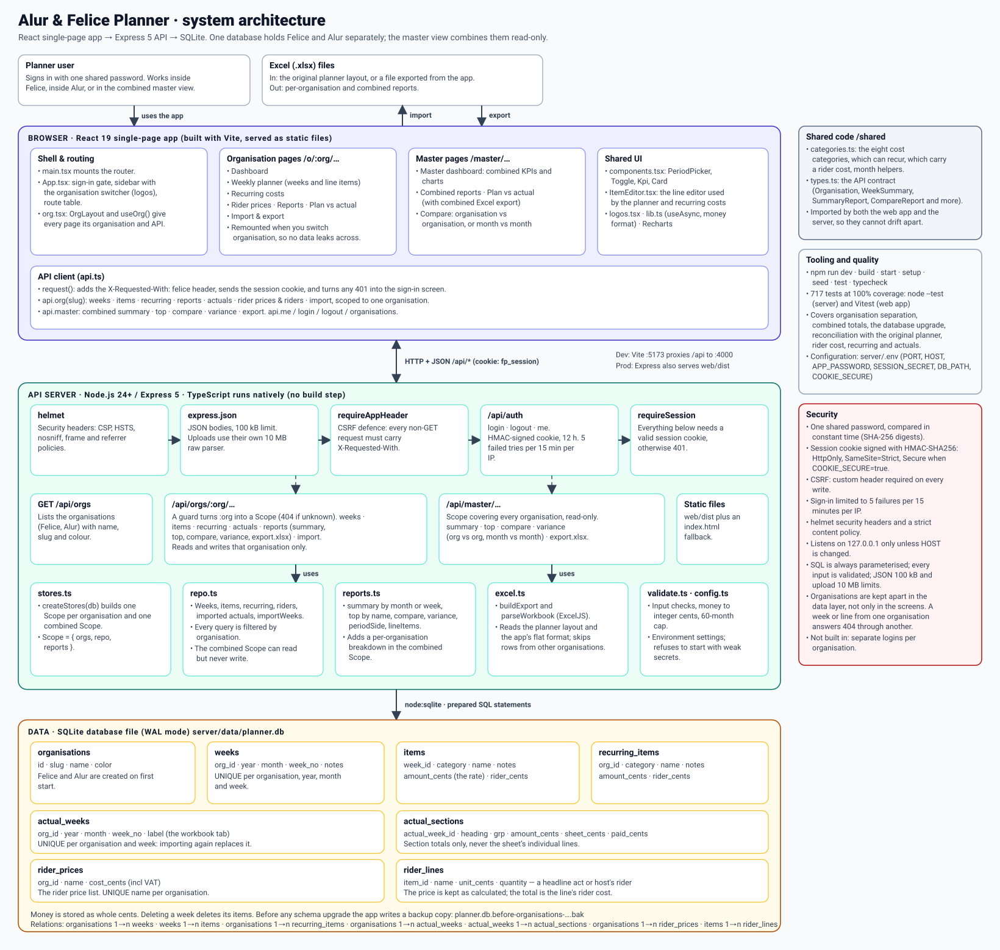

# Alur & Felice Planner

A web app for planning and reporting the weekly event costs of two sister companies, **Felice** and **Alur**.

* Each company has its **own** weekly planner, recurring costs, dashboard, reports, comparisons and Excel import/export.
* A **master view** combines both companies for a single dashboard, combined reports and an organisation-vs-organisation comparison. It is read-only.
* Every headline act and host is captured with a **rate and a rider cost**; the totals always add up.
* It started as an Excel workbook (the "weekly planner"). The app reproduces that workbook's figures to the cent, and explains where the old sheet's own totals were wrong.



## What you can do

| | |
|---|---|
| **Plan** | Add weeks and record each cost line by category: headline acts, resident DJs, rider costs, standard costs, physical marketing, social media, hosts and promoters, other. |
| **Recur** | Keep a list of standing costs per company that is added to every new week, and edit it at any time. |
| **See** | A dashboard per company with key figures, monthly and weekly charts, the category split, and top acts and hosts. Default view: the last 12 months. |
| **Report** | Month-by-month or week-by-week breakdowns, top spend by name, export to Excel. |
| **Compare** | Month vs month, week vs week, and (master view) Felice vs Alur. |
| **Plan vs actual** | Import each week's actual spend from the expense workbook (one tab is one week, section totals only) and see planned against actual, per company and combined, on a report and on the dashboards. |
| **Combine** | A master dashboard and combined reports across both companies, with each company's share. |
| **Import / export** | Load the original planner workbook or an earlier export, with a preview and warnings; download reports as Excel. **Every import has a downloadable template with examples** (planned weeks, original planner layout, resident DJs as Excel or CSV, rider prices, actual expenditure). |
| **Rider calculator** | Keep a rider price list (cost incl VAT, import it from the Rider Calc workbook), then work out the total rider cost of each headline act and host from the items asked for. The total becomes that booking's rider cost. |
| **Resident DJs** | Add each DJ to a week with their rate, or import a list (Excel or CSV). The Resident DJs cost comes from the DJs. A payment schedule groups the week's DJs in batches of 5, and a report shows how often each DJ was booked per month. |

## Quick start

You need **Node.js 24 or newer**.

**Where it runs.** The server runs on Windows, macOS and Linux. The web app runs in any current browser, including Safari on iPhone and iPad, and Chrome or Edge on Windows, Linux and Android. The commands below are the same in every shell. For phones and tablets see [Using it on a phone or tablet](docs/operations.md#using-it-on-a-phone-or-tablet-iphone-ipad-android).

```bash
cd felice-planner
npm install
npm run setup     # creates server/.env with a random password (printed once)
npm run dev       # then open http://localhost:5173
```

Sign in with the password from `server/.env` (`APP_PASSWORD`).

For a single-process run: `npm run build`, then `npm start`, and open <http://127.0.0.1:4000>.

To load the original planner workbook into Felice:

```bash
npm run seed -- --file "../../calc/Weekly Planner - April - Dec.xlsx" --year 2026 --org felice
```

## Documentation

| Document | For | Contents |
|---|---|---|
| [User guide](docs/user-guide.md) | People using the app | Every screen, step by step, and common tasks. |
| [Architecture](docs/architecture.md) | Developers and reviewers | Building blocks, data model, key flows, security model, design decisions, limitations. Diagram: [architecture.svg](docs/architecture.svg). |
| [API reference](docs/api.md) | Developers | Every endpoint with request and response examples. |
| [Operations guide](docs/operations.md) | Whoever runs it | Setup, configuration, backups and restore, upgrades, sharing safely, **moving to another machine (Windows)**, troubleshooting, project layout. |

## Technology

| Layer | Choice |
|---|---|
| Web app | React 19, TypeScript, Vite, React Router, Recharts |
| API | Node.js 24+, Express 5, TypeScript run natively (no server build step) |
| Database | SQLite through Node's built-in `node:sqlite` (one file) |
| Excel | ExcelJS |
| Security | helmet, signed session cookie, CSRF header, rate-limited sign-in |
| Tests | Node's built-in test runner for the server (276 tests) and Vitest with Testing Library for the web app (441 tests), at 100% coverage |

All dependency versions are pinned exactly, and `npm audit` reports no vulnerabilities.

## Project layout

```
felice-planner/
├── docs/       documentation and the architecture diagram
├── shared/     cost categories and the API contract, used by both sides
├── server/     API, database, reports, Excel, tests
└── web/        the React app
```

See the [operations guide](docs/operations.md#13-project-layout) for the full file list.

## Checks

```bash
npm run typecheck      # server, web and shared code
npm test               # server (276 tests: 275 run, 1 optional live-database check) and web (441 tests)
npm run test:coverage  # the same, failing unless statements, branches, functions and lines are all 100%
npm run build          # production build of the web app
```

## Security at a glance

* One shared password opens **both** companies. There are no separate logins per company.
* The app listens on `127.0.0.1` only by default. Put HTTPS in front of it before sharing it, and set `COOKIE_SECURE=true`.
* Keep `server/.env` and `server/data/` private; both are excluded from version control.

Details are in the [architecture](docs/architecture.md#6-security-model) and [operations](docs/operations.md#9-sharing-the-app-on-a-network) documents.
