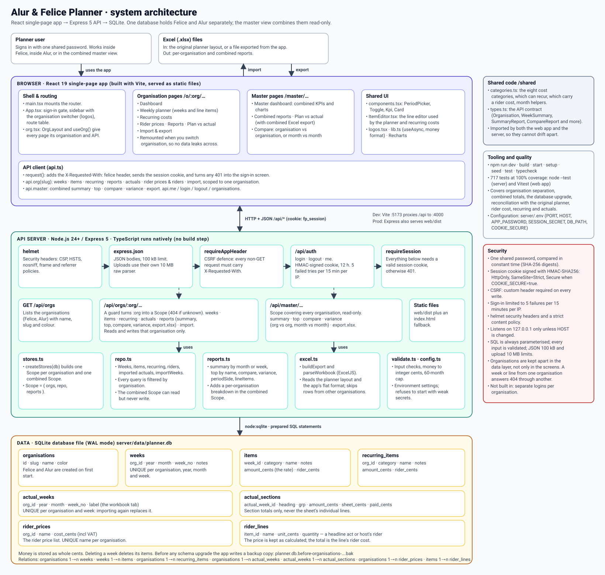
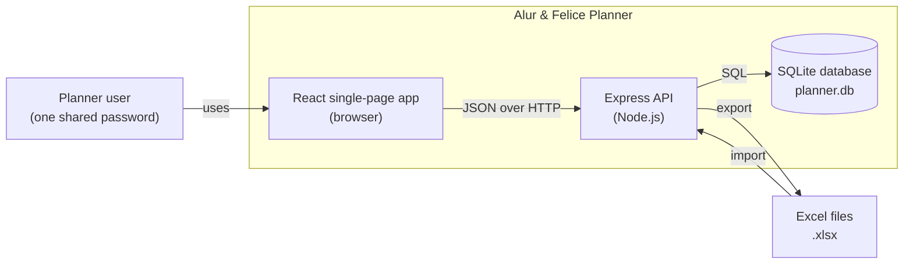
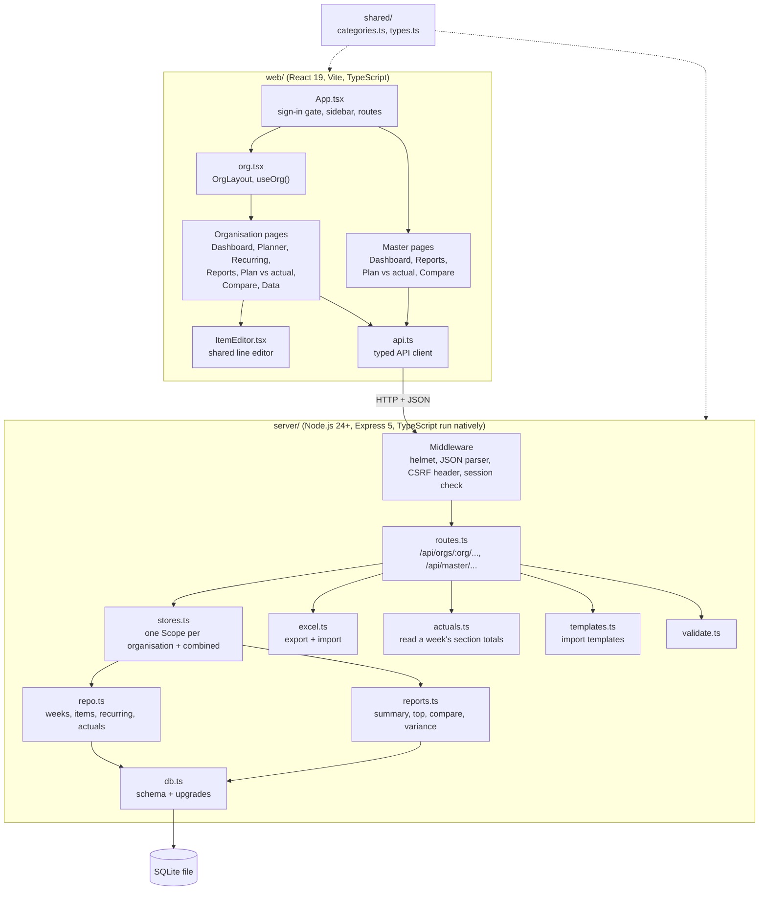
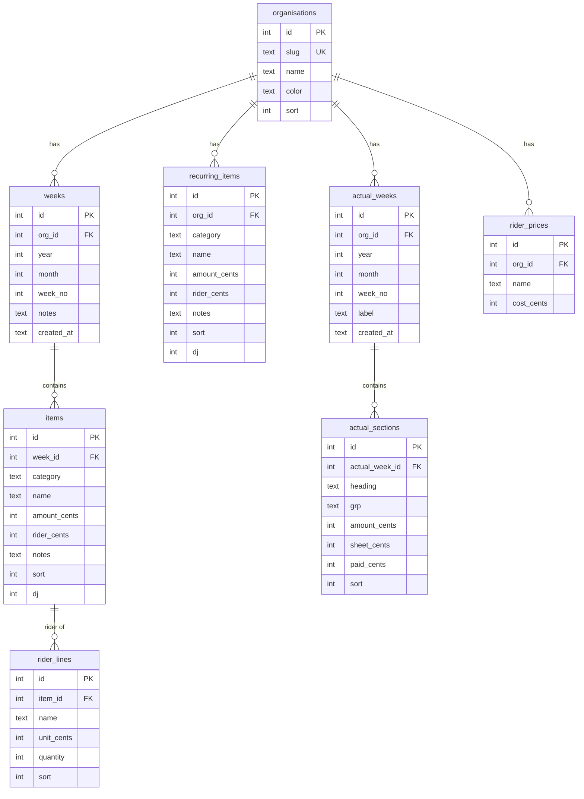
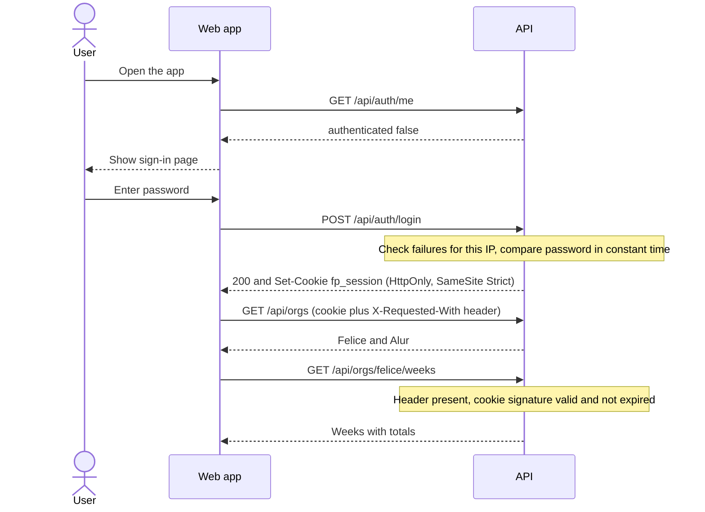
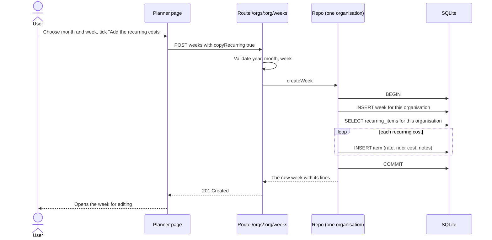
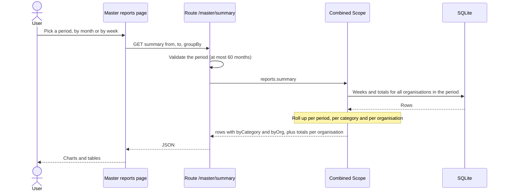
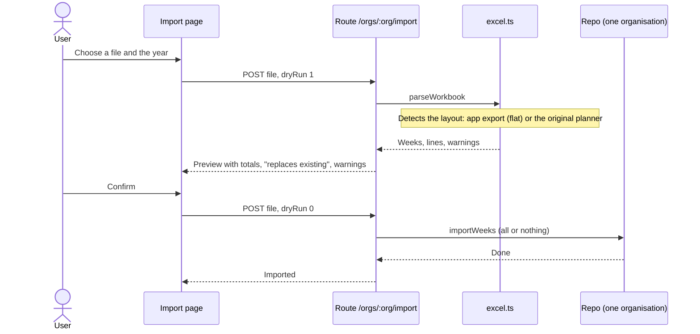
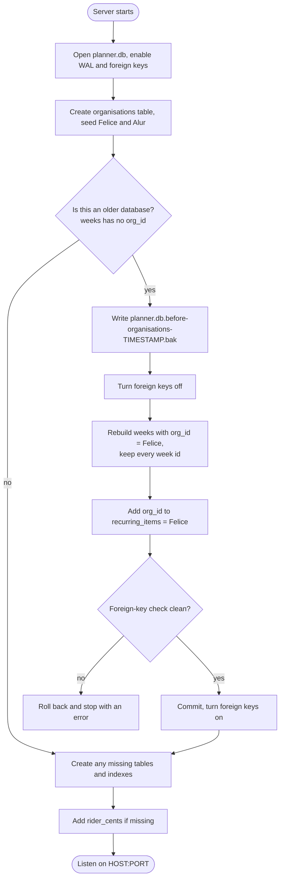
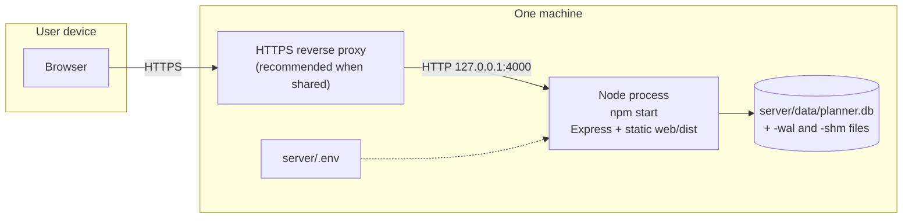

# Architecture

Alur & Felice Planner is a web application for planning and reporting weekly event costs for two sister companies, **Felice** and **Alur**. Each company has its own planner, recurring costs, dashboard, reports, comparisons and Excel import/export, and can compare its plan with the **actual expenditure** imported each week. A **master view** combines both, read-only.



*The full diagram is [architecture.svg](architecture.svg). The sections below explain each part and add the data model and the main flows.*

## Contents

1. [Design goals](#1-design-goals)
2. [System context](#2-system-context)
3. [Building blocks](#3-building-blocks)
4. [Data model](#4-data-model)
5. [Key flows](#5-key-flows)
6. [Security model](#6-security-model)
7. [Design decisions](#7-design-decisions)
8. [Deployment](#8-deployment)
9. [Testing](#9-testing)
10. [Known limitations](#10-known-limitations)

---

## 1. Design goals

| Goal | How the design meets it |
|---|---|
| Two companies, kept apart | Every week and recurring cost carries an `org_id`. All queries are filtered by it in the data layer, not only in the screens. |
| One combined view | The master view reads the same tables across all organisations and cannot write. |
| Plan checked against reality | Actual spend is imported one week at a time as section totals, into separate tables, so a plan can never be changed by an import. |
| Figures that always add up | Totals are calculated, never typed in. Money is stored as whole cents. A test suite reconciles the app with the original planner workbook. |
| Easy to run and maintain | One Node process, one SQLite file, no build step on the server, very few dependencies. |
| Safe to expose | Signed session cookie, CSRF header, rate-limited sign-in, strict security headers, validated input, parameterised SQL. |
| Safe to upgrade | Schema upgrades back up the database first and are tested against an old-format database. |

## 2. System context



There are no external services. The application does not call out to the internet.

## 3. Building blocks



### 3.1 Web app (`web/`)

| Part | Responsibility |
|---|---|
| `App.tsx` | Sign-in gate, sidebar with the organisation switcher, the route table. Loads the organisation list once after sign-in. |
| `org.tsx` | `OrgLayout` reads `:org` from the URL and provides `useOrg()` (the organisation, its API client, a link helper). It is keyed by the organisation, so switching company remounts the page and no state can leak across. |
| `pages/` | One file per screen. Organisation pages use `useOrg()`. Master pages use `api.master`. |
| `ItemEditor.tsx` | The line editor (add, edit, delete) used by both the weekly planner and the recurring-costs page. It does not know where lines are stored; it is given `add / update / remove` functions. |
| `api.ts` | The only place that calls `fetch`. Adds the CSRF header, sends the cookie, converts a 401 into the sign-in screen. |
| `components.tsx`, `lib.ts` | Shared UI (period picker, toggle, KPI card), money formatting, the `useAsync` loading hook. |
| `logos.tsx` | Shows each organisation's logo. Organisations without a logo show their name. |
| `RiderCalculator.tsx` | The rider calculator panel on a headline act or host: add items from the price list, set how many, see the total, save it as the booking's rider cost. |
| `ActualImport.tsx` | The import card on the Import & export page: choose the workbook and tab, preview, adjust section totals, import, and list or remove imported weeks. |
| `variance.tsx` | Planned-against-actual pieces shared by the company page, the master page and the dashboard cards (the summary card, the cost-group table, the over/under wording). |

Routes: `/master`, `/master/reports`, `/master/actuals`, `/master/compare`, and `/o/:org` with `planner`, `planner/:weekId`, `recurring`, `rider-prices`, `reports`, `actuals`, `compare`, `data`.

### 3.2 API server (`server/src/`)

| File | Responsibility |
|---|---|
| `index.ts` | Start-up: reads the settings (and stops with a message if they are weak), opens the database, listens, and shuts down cleanly on SIGINT and SIGTERM. |
| `app.ts` | `createApp(config, db, webDist)` builds the Express app: security headers, parsers, the `/api` router, static files, error handler. It is a function, so the tests can start a server in-process on any port. |
| `auth.ts` | Sign-in, sign-out, session check, rate limiting, and the CSRF header check. |
| `config.ts` | Reads environment settings and refuses to start with a weak password or secret. |
| `db.ts` | Opens the database, creates the schema, seeds the organisations, and runs upgrades. |
| `stores.ts` | `createStores(db)` makes one **Scope** (`{ orgs, repo, reports }`) per organisation and one combined Scope. |
| `repo.ts` | All reads and writes of weeks, line items, recurring costs, resident DJs (add, bulk import, payment schedule), riders and rider prices, and imported actuals. Takes the list of organisations it may touch. |
| `reports.ts` | Summaries by month or week, top spend by name, comparisons, line-item listings, resident DJ bookings per month, and planned against actual (`variance`). |
| `excel.ts` | Builds exports and the payment schedule, and parses imports, resident DJ lists and rider price lists (ExcelJS). |
| `templates.ts` | Builds the downloadable import templates (planned weeks, original planner layout, resident DJs as Excel and CSV, rider prices, actual expenditure) with example rows and a READ ME sheet. `GET /api/templates/:id` serves them. |
| `actuals.ts` | Reads one tab of the weekly expense workbook: finds each section's SUBTOTAL, maps the section to a cost group, cross-checks the tab total, and applies any adjusted amounts. |
| `backup.ts` | `npm run backup`: a safe single-file copy of the database. |
| `routes.ts` | The HTTP endpoints. See the [API reference](api.md). |
| `validate.ts` | Input checks and the `HttpError` type. Converts rand amounts to integer cents. |
| `seed.ts`, `setup.ts` | Command-line helpers: load a workbook; create `.env`. |

### 3.3 Shared code (`shared/`)

`categories.ts` defines the eight cost categories, which of them can recur, which carry a rider cost, the six **variance groups** used to compare plan with actual (`VARIANCE_GROUPS`, `groupOfCategory`), and the month helpers. `types.ts` defines the API contract. Both the web app and the server import these files, so the two sides cannot drift apart. Types are checked at build time by `npm run typecheck`.

### 3.4 Scopes: how organisations are kept apart

The heart of the design is that data access is created *for a set of organisations*:

```ts
createRepo(db, [felice.id])            // Felice only: can read and write
createRepo(db, [alur.id])              // Alur only: can read and write
createRepo(db, [felice.id, alur.id])   // combined: can read, cannot write
```

Every SQL statement includes `org_id IN (…)` for that set. Write methods first call `writeOrg()`, which throws when the repo covers more than one organisation. As a result:

* A week or line item from Felice answers **404** when requested through Alur.
* The master endpoints have no write routes, and the combined repo would refuse a write anyway.
* The cost categories and reports are identical for both companies, so the combined totals are a plain sum.
* Imported actuals follow the same rule: importing, replacing and deleting need a single-company repo, and another company's actuals answer 404.

## 4. Data model



| Table | Notes |
|---|---|
| `organisations` | Created on first start: Felice and Alur. To add a company, add a row to the list in `server/src/db.ts` and restart. |
| `weeks` | `week_no` is 1 to 5 within a month. **Unique per organisation, year, month and week number**, so both companies can have "November W1". Deleting a week deletes its items (`ON DELETE CASCADE`). |
| `items` | One cost line in a week. `category` is one of the eight keys below. |
| `recurring_items` | The standing costs added to every new week of an organisation. Only categories that can recur are accepted. |
| `rider_prices` | An organisation's rider price list: item and cost including VAT. The name is unique per organisation, ignoring capitals. |
| `rider_lines` | The rider of one headline act or host: the items asked for, each with the **price it had when calculated** and a quantity. Deleted with its item (`ON DELETE CASCADE`), so removing a line or a week removes its rider. |
| `actual_weeks` | One imported week of actual expenditure. **Unique per organisation, year, month and week number**, so importing a week again replaces it. `label` is the workbook tab it came from. It is separate from `weeks`: an actual week can exist with no plan. |
| `actual_sections` | One row per section total of an imported week (`grp` is the variance group). `amount_cents` is what is used and `sheet_cents` is the subtotal printed on the sheet; they differ only when the amount was adjusted at import. **Only totals are stored, never the sheet's individual lines.** Deleted with their week (`ON DELETE CASCADE`). |

**Money.** All amounts are whole cents (`amount_cents`, `rider_cents`) so totals never drift by fractions of a cent. The API accepts and returns rand with decimals, and `validate.ts` converts on the way in.

**Rate and rider cost.** For headline acts and hosts, `amount_cents` is the *rate* and `rider_cents` is that booking's *rider cost*. Both are required. In reports, the rider cost of every headline act and host is added to the **Rider Costs** category, and the line's total is rate plus rider. For every other category `rider_cents` is 0.

**Resident DJs.** A resident DJ is an `items` row in the `resident` category with `dj = 1`: `name` is the DJ, `amount_cents` is their rate, and `week_id` links them to the week. The same flag exists on `recurring_items`, where it marks a standing DJ that is copied into every new week as that week's own DJ. Lines with `dj = 0` are the older lump-sum Resident DJs lines, and existing data keeps `dj = 0`, so no figure changes on upgrade.

* **The cost is derived from the DJs.** In a week that has at least one `dj = 1` line, `dj = 0` lines in the `resident` category are not counted. The rule is one SQL condition (`COUNTED_ITEM` in `db.ts`) used by the totals, the top list and the export, so every report agrees. Nothing is deleted: remove the DJs and the lump sum counts again. The web app shows the ignored line struck through with "Not counted".
* **One booking per DJ per week.** Unique indexes on `(week_id, lower(trim(name)))` and `(org_id, lower(trim(name)))`, where `dj = 1`, mean a DJ is in a week once whatever the capitalisation. The repo checks first, to give a clear `409`.
* **A booking is a week.** The bookings-per-month report counts DJ lines, so a DJ on four weeks of a month was booked four times.
* **Payment schedule.** Computed on request from the week's DJ lines, in name order, in batches of `PAYMENT_BATCH_SIZE` (5, in `shared/categories.ts`). Only rates are paid; rider costs are separate lines. Nothing is stored, so it always matches the week.

**Rider calculator.** The rider cost of a headline act or host is still `items.rider_cents`, so every total and report reads it as before. When a rider is worked out, `setItemRider` replaces the item's `rider_lines` and sets `rider_cents` to their total in one transaction.

* **Prices are snapshots.** A rider line stores its own unit price, so editing `rider_prices` never rewrites a past week.
* **The cost cannot drift from its items.** While a line has `rider_lines`, `updateItem` refuses a different `rider_cents` (`400`), so the figure can only change in the calculator. Moving the line out of headline acts and hosts deletes its rider lines. Lines with no `rider_lines` keep the typed-in cost, so existing data is unchanged on upgrade.
* **Items are costed in whole cents:** unit cents times quantity, summed, so a rider total is exact. The tests reproduce 21 rider totals of the Rider Calc workbook to the cent.
* **Not copied by recurring costs.** A recurring host brings its rider cost into a new week, not its items.

**Planned vs actual.** The sheet reports expenses in seven sections, not the app's eight categories, so the comparison uses six **groups** (`VARIANCE_GROUPS` in `shared/categories.ts`): Headline Acts, Resident DJs, Hosts & Promoters, Rider Costs, Standard Costs (planned Standard; sheet RESIDENTS and BOTTLE GIRLS) and Marketing & other (planned Physical Marketing, Social Media and Other; sheet Miscellenious).

* **Variance is actual minus planned**, so positive means overspent. The report returns planned and actual; the screens subtract them and show ▲/▼ with the words *over plan* and *under plan*, never colour alone.
* **Only weeks that have actuals are compared.** `planned` covers those weeks only; `plannedAll` is the whole plan for the period, for context. A week with actuals but no plan counts against 0 (`weeksUnplanned`).
* **The plan is read the same way everywhere.** Planned totals skip a lump-sum Resident DJs line once individual DJs exist (`COUNTED_ITEM`), so the variance report agrees with every other report.
* **Miscellaneous may mix companies.** The sheet's Miscellaneous section can hold both companies' costs. With totals only there is nothing to split automatically, so the import preview lets the user set the section amount, and the week is marked adjusted.

### Cost categories

| Key | Label | Can recur | Carries a rider cost |
|---|---|:-:|:-:|
| `headline` | Headline Acts | no | yes |
| `resident` | Resident DJs | yes | no |
| `rider` | Rider Costs | yes | no |
| `standard` | Standard Costs (MC, Graphics, Photographer, Bottle Girls) | yes | no |
| `physical` | Physical Marketing (Corex boards, billboards, mobile boards) | yes | no |
| `social` | Social Media | yes | no |
| `hosts` | Hosts & Promoters | yes | yes |
| `other` | Other | no | no |

## 5. Key flows

### 5.1 Sign-in and an authenticated request



### 5.2 Adding a week with the recurring costs



If the week already exists for that organisation the repo answers **409**. Editing the recurring list later only affects weeks created afterwards.

### 5.3 A combined (master) report



In the by-week view, the same week number from both companies is shown as one row, with each company's share in `byOrg`.

### 5.4 Excel import



* **Flat format** (what the app exports): columns `[Organisation] Year, Month, Week, Category, Name, Amount, Rider cost, Notes`. If an Organisation column is present, rows belonging to another organisation are skipped and a warning says how many.
* **Original planner layout**: weeks across the top, categories down the side. The importer reads the cached cell values, derives each section, keeps any shortfall between a section's total and its named lines as an "(unallocated)" line, and **warns when the sheet's own TOTALS row disagrees** with the sum of the lines.
* Importing a week **replaces** that week's lines. Everything is inside one transaction.

### 5.5 Actual expenditure import

```mermaid
sequenceDiagram
    actor U as User
    participant W as Import card
    participant R as Route /orgs/:org/actuals
    participant A as actuals.ts
    participant P as Repo (one organisation)
    U->>W: Choose the expense workbook
    W->>R: POST file to /actuals/sheets
    R->>A: listSheets
    A-->>W: Tabs with totals, suggested tab
    U->>W: Pick tab, month, year, week; Preview
    W->>R: POST file to /actuals/import, dryRun 1 (+ adjust)
    R->>A: readSheet, applyAdjustments
    Note over A: Reads each section SUBTOTAL only, cross-checks the tab total
    R->>P: planned totals for that week
    R-->>W: Section totals, planned vs actual, warnings, replaces?
    U->>W: Import
    W->>R: POST file to /actuals/import
    R->>P: importActualWeek (replaces that week, one transaction)
    R-->>W: Imported
```

* The workbook is uploaded again for each step (it is small), so nothing is kept on the server between preview and import.
* A section with no usable SUBTOTAL falls back to adding its amounts, with a warning. A tab total (cell D3) that disagrees with the section subtotals also warns.
* The paid column of the SUBTOTAL row is stored if it holds a number; today it is blank in the real file, so paid is 0.

### 5.6 Database upgrade at start-up



Foreign keys are turned off during the rebuild because dropping the old `weeks` table would otherwise cascade-delete every line item. The upgrade is idempotent: running it again changes nothing and writes no second backup.

## 6. Security model

| Concern | Control |
|---|---|
| Authentication | One shared password. Compared by SHA-256 digest with `timingSafeEqual`, so timing does not reveal it. |
| Sessions | Stateless signed cookie: `base64url(payload).HMAC-SHA256`. Payload holds only an expiry (12 hours). `HttpOnly`, `SameSite=Strict`, `Secure` when `COOKIE_SECURE=true`. Rotating `SESSION_SECRET` ends every session. |
| Brute force | 5 failed sign-ins per 15 minutes per IP, then 429. |
| CSRF | `SameSite=Strict` plus a required custom header (`X-Requested-With: felice`) on every non-GET request. A cross-site form or image cannot set it. |
| Injection | Every SQL statement is prepared with bound parameters. IN-lists are built from numeric ids only. |
| Input | Each endpoint validates type, range and length (names 200, notes 1000, amounts up to 1,000,000,000, periods up to 60 months). JSON bodies are limited to 100 kB, uploads to 10 MB, and uploads must start with the ZIP signature. |
| Browser hardening | `helmet`: strict Content-Security-Policy (`script-src 'self'`), HSTS, `nosniff`, frame and referrer policies. |
| Network exposure | Listens on `127.0.0.1` by default. Put HTTPS in front before setting `HOST` to anything wider. |
| Secrets | Startup fails if `APP_PASSWORD` is under 12 characters or `SESSION_SECRET` under 32. `.env` is git-ignored and created with mode `0600`. |
| Data separation | Organisation scoping is enforced in the data layer; cross-organisation requests answer 404. |
| Dependencies | Versions are pinned exactly. `uuid` is overridden to a patched release; `npm audit` reports no vulnerabilities. |

**Not built:** separate logins per organisation, an audit trail of who changed what, and per-user roles. Anyone who can sign in can read and edit both companies.

## 7. Design decisions

| Decision | Why | Alternative considered |
|---|---|---|
| One database with an `org_id` on weeks and recurring costs | Combined reports are a simple query across both companies. One file to back up. | A database per company: stronger isolation, but combined reporting would need to merge two databases. |
| SQLite via Node's built-in `node:sqlite` | No native build step and no extra dependency. Plenty for one team. | Postgres: better for many concurrent writers, but needs a server to run. |
| TypeScript run directly by Node (no server build) | Fewer moving parts. `tsc --noEmit` still type-checks. | Compile to JavaScript: adds a build step and output folder. |
| Money as integer cents | Totals are exact. | Floating point: tiny drifts show up in reconciliation. |
| Read-only combined scope enforced in code | A combined screen can never write to the wrong company. | Trusting the UI not to offer write buttons. |
| Rider cost captured on the act or host | Matches how bookings are negotiated; totals by category stay correct. | A separate rider table: more screens, easy to forget. |
| Recurring costs as a list, copied when a week is created | Past weeks never change when the list is edited, so old reports stay true. | Live-linked recurring costs: editing would rewrite history. |
| Shared `types.ts` between web and server | One source for the API contract. | Duplicating types: they would drift. |
| Sign-in with one password | Right size for a small team that shares access. | Accounts and roles: more to build and manage. |

## 8. Deployment



| Mode | How | Ports |
|---|---|---|
| Development | `npm run dev` runs the API (restarts on change) and Vite together. Vite proxies `/api` to the API. | Web 5173, API 4000 |
| Production | `npm run build` then `npm start`. One process serves both the API and the built web app. | 4000 (or `PORT`) |

Back up the database with SQLite's own copy (see [operations](operations.md#5-backups)); a plain file copy can miss recent writes while the server is running.

## 9. Testing

`npm test` runs two suites, and `npm run test:coverage` runs them with a **100% threshold** for statements, branches, functions and lines.

| Suite | Runner | Tests | Covers |
|---|---|---|---|
| `server/test` | Node's built-in test runner | 276 (275 run, 1 optional) | `server/src` and `shared/` |
| `web/test` | Vitest, jsdom and Testing Library | 441 | `web/src` |

The server tests drive the real server over HTTP (`app.ts` on an ephemeral port, in-memory database), call the data layer directly, and start the real programs as child processes (`index.ts`, `setup.ts`, `backup.ts`, `seed.ts`): the child processes inherit `NODE_V8_COVERAGE`, so their coverage is merged into the report. The web tests replace `fetch` with a router of canned responses and render each screen with its real components; Recharts is replaced by a light stand-in that exposes the data and formatters it is given. Temporary files and folders are removed when a run ends. Defensive code that could not be reached (for example, a fallback for a column that is `NOT NULL`) was removed rather than excluded, and no file is excluded from coverage.

Server suites:

| Suite | What it proves |
|---|---|
| `planner-reconcile` | Importing the original workbook gives the same figure as the sheet for every category and week, and every difference from the sheet's own TOTALS row is explained to the cent. |
| `organisations` | Companies are separated, cross-organisation access answers 404, the combined view adds up and cannot write, the combined Excel file imports cleanly into one company, and an old-format database upgrades with nothing lost. |
| `recurring` | New weeks start from the recurring list, edits affect later weeks only, and headline acts cannot be recurring. |
| `rider-cost` | Rate and rider cost are stored separately and roll into the right categories and totals. |
| `resident-djs` | The Resident DJs cost is the sum of the DJs, and a lump-sum line stops counting (and counts again if the DJs go); a DJ can be in a week once; recurring DJs are copied into new weeks; Excel and CSV bulk import, including South African formats, with preview, updates and warnings; payment batches of 5 add up to the week; bookings per month; Felice and Alur stay apart; an older database upgrades with its totals unchanged. |
| `actuals-import` | Reading a week's section totals: subtotals, fallbacks and warnings, the tab-total cross-check, group mapping, adjusted amounts, bad input, and the real expense workbook (one tab is one week, totals match the sheet to the cent). |
| `variance` | Plan against actual: only weeks with actuals are compared, variance is actual minus planned, groups add up to totals, unplanned weeks, replace-on-reimport, delete leaves the plan intact, Felice and Alur stay apart, and the combined view adds up and cannot write. |
| `rider-calc` | The price list (add, change, remove, one per name, per organisation) and its import (finds the list on any tab, trims names, skips the `0` placeholder and repeats, a preview changes nothing). The calculator: totals to the cent, hosts too, the Rider Costs report and week total follow, prices are snapshots, the typed-over lock, cascade on delete, other companies get 404. Against the real Rider Calc workbook: the 30-item price list imports with no warnings and all 21 artist and host totals match the sheet to the cent. |
| `app` | Security headers (HSTS and upgrade-insecure-requests only when `COOKIE_SECURE=true`), the cookie flags, the guard on `/api` (401 without a session, 403 without the header), the built web app (files, page routes, 503 before the first build and no restart after it), and the error handler (HttpError, malformed JSON, 413, unexpected 500 with a safe message). |
| `auth` | Sign-in and the signed session cookie on fake requests: forged, tampered, malformed and expired cookies, the 5-failure limit and its 15-minute window, the 1000-address clean-up, sign-out, and the CSRF header. |
| `routes` | Every endpoint with its refusals, and organisation isolation. |
| `excel` | The cell helpers; the three importers with every bad-row warning, the 60-warning cap and the combined-export filter; both exports. |
| `config`, `validate`, `categories`, `db`, `repo` | Settings, input checks, shared code, database upgrades (including a failed one that is undone) and transactions, and data-access edge cases. |
| `cli` | `npm start`, `setup`, `backup` and `seed` as real processes. |
| `templates` | Every import template goes through the real importer with no warnings: planned weeks (flat), the original planner layout (every week total matches its TOTALS row), resident DJs in Excel and CSV (onto a week and into the recurring list), and the actual-expenditure workbook (tabs listed, subtotals and paid read, imports and replaces). A change to an importer that a template no longer satisfies fails here. |

The optional check compares a live database with the workbook: `FP_LIVE_DB=./data/planner.db FP_EXCLUDE=headline,hosts npm test -w server`.

## 10. Known limitations

* **One shared login.** Both companies are visible to anyone who can sign in.
* **Same categories for both companies.** Different categories per company would need a per-organisation category list.
* **No audit trail.** The app does not record who changed a figure.
* **Last write wins.** Two people editing the same line at once can overwrite each other.
* **Sessions cannot be revoked one by one.** Sign-out clears the browser's cookie; rotating `SESSION_SECRET` ends all sessions.
* **Sign-in attempt counts live in memory** and reset when the server restarts. Behind a reverse proxy they are counted per proxy address, so one person's failed attempts can lock others out for 15 minutes.
* **A resident DJ is in a week once.** A DJ who plays two nights in one week is one line with the combined rate, and counts as one booking in the bookings report.
* **The payment schedule is a list, not a ledger.** It does not record which payments have been made; the Excel file has an empty Paid column to tick off.
* **Actuals are compared as totals only.** The sheet's individual lines are not stored, so a variance cannot be traced to a line, and Miscellaneous (marketing and other) cannot be split by company automatically: set the figure at import.
* **Paid is only as good as the sheet.** Amount paid is read from the sheet's SUBTOTAL row; while that column is empty, everything shows as outstanding.
* **Week numbers are 1 to 5 within a month**, as in the original planner. The sheet had no week 3 in June; the app simply has no such week unless you add one.
* **Single machine.** SQLite suits one server. Many simultaneous writers would call for a client/server database.
